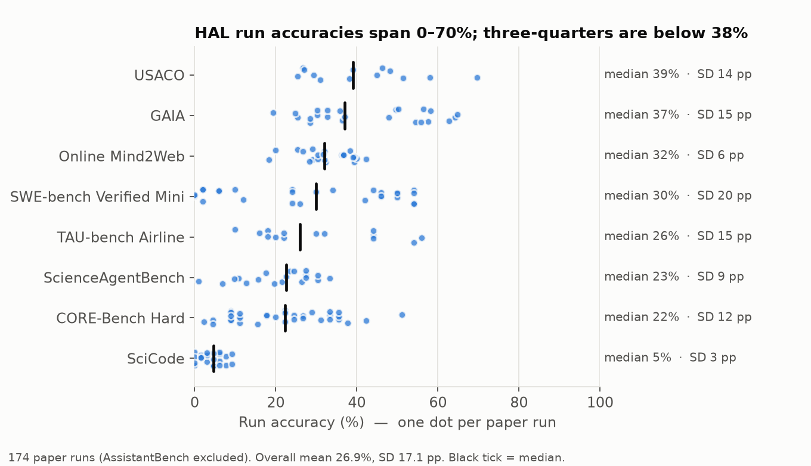
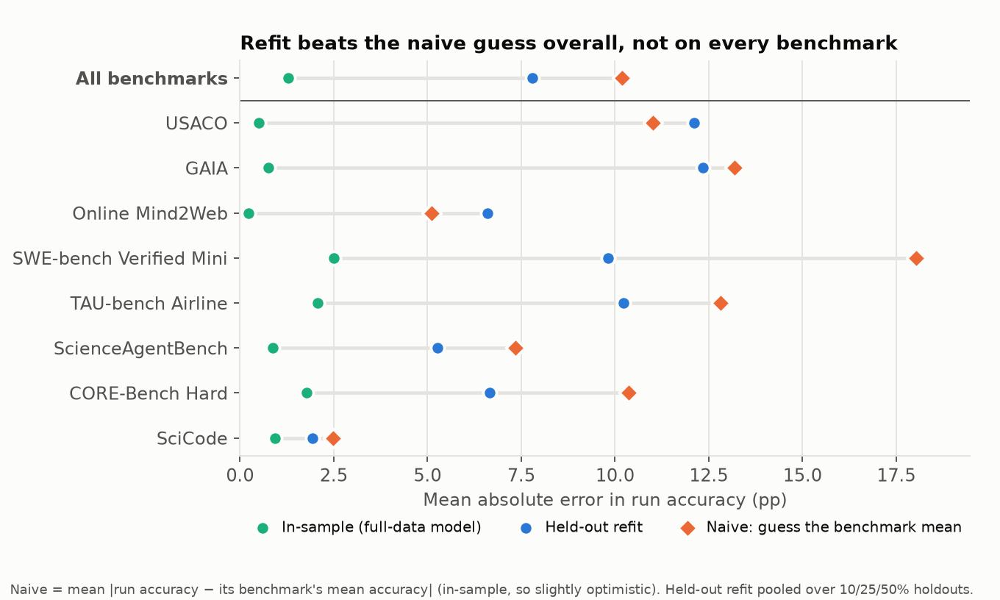
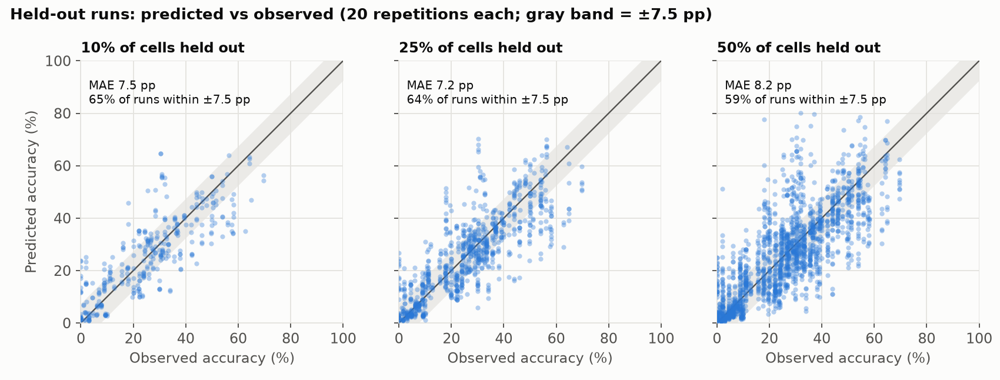
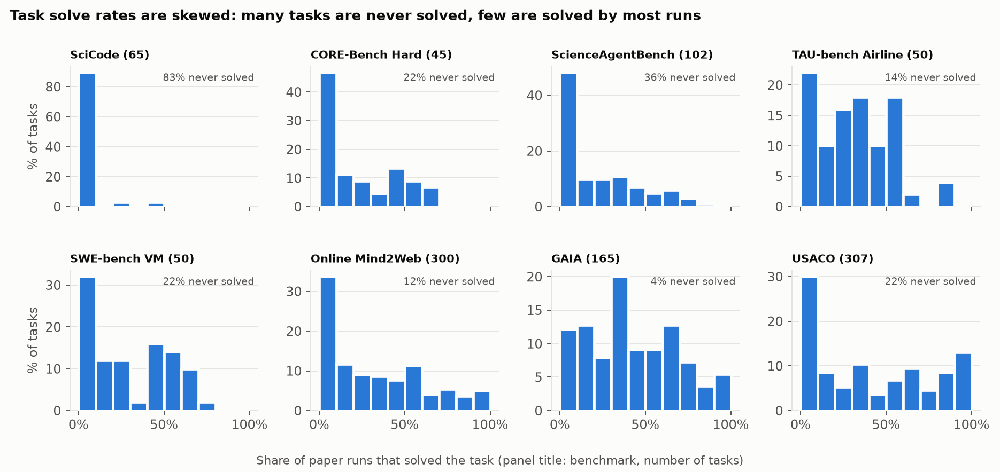
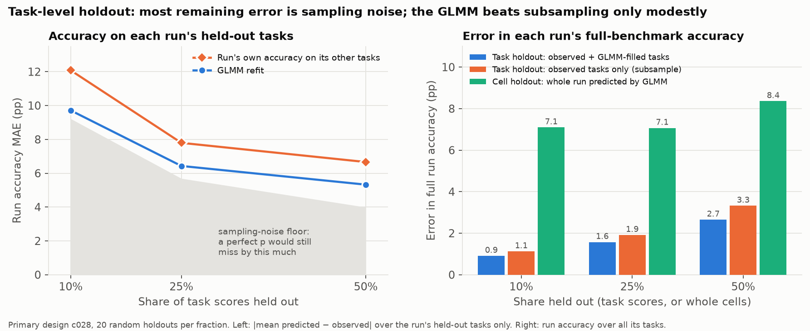

# HAL interpolation analysis: binomial GLMER over task-level agent results

**Question.** The HAL paper (Kapoor et al., arXiv 2510.11977) paid for fresh runs of every
(model × scaffold × benchmark × configuration) combination it reports. How well could those
results be recovered by an IRT-style mixed-effects logistic regression fit on only a subset of runs?

**Short answer.**
* Fit on all 174 paper runs (21,333 task outcomes), the selected model reproduces each run's accuracy to
  **3.1 pp MAE**. Task-level AUC is 0.91, and conditional R² is 0.71.
* With 10–50 % of the combinations removed and the model refit, held-out run accuracy is predicted to
  **7.2–8.2 pp MAE**. The naive baselines reach 8.9–10.8 pp. Held-out task-level AUC is 0.84–0.86.
* Holding out individual task scores instead (§4c), the refit fills in a run's full accuracy to **1.0 / 1.7 / 2.9 pp** with 10 / 25 / 50 % of its tasks missing. That is only 0.2–0.4 pp better than reporting the accuracy on the observed tasks alone.
* For runs added after the paper, MAE is **5.8 pp** for runs whose model is already known and **11.8 pp** for runs on brand-new models.

Design decisions, including the one change made after fitting, are in [`DESIGN.md`](DESIGN.md).
Takeaways and the latent factors are in [`summary.md`](summary.md).

---

## 1. Data

| Item | Value |
|---|---|
| Source | HF `agent-evals/hal_traces`: 380 encrypted trace zips, 113 GB. They were streamed and decrypted with the public hal-harness password, keeping only config, per-task scores, latencies and usage (`scripts/extract_hal_traces.py`). |
| Paper runs | 186 runs, matched to zips from the paper's LaTeX appendix tables and the leaderboard links (`data/meta/hf_runs.csv`, `data/meta/README.md`). |
| Modelled | **174 runs**: the 186 minus 12 AssistantBench runs (see below). They cover 172 cells, 8 benchmarks, 15 models, 10 scaffolds, 4 effort levels and 1,084 tasks, for **21,333 task-level binary outcomes**. |
| Out-of-time test | 48 runs uploaded after the paper's HF snapshot (2025-10-08): new models (Claude Sonnet/Haiku/Opus 4.5, Gemini 3 Pro) and new scaffolds (Claude Code, TAU-bench Tool Calling). |
| Outcome | HAL's own per-task success flag, i.e. the quantity HAL's headline accuracy is computed from. |

**Data integrity.**
* Every modelled paper run reproduces the paper's reported accuracy exactly. Four pairs were averaged over two runs in the paper, and their means match.
* Getting there needed three fixes, all documented in the scripts:
  1. **15 SWE-bench zips were re-uploaded to HF in Nov 2025 with different task results.** For example, Claude 3.7 Sonnet with the HAL Generalist scaffold is 24 % in the paper but 38 % in the current file. The paper-time versions were taken from HF commit `1bf4166d`.
  2. ScienceAgentBench stores per-task success only inside `raw_eval_results`.
  3. HAL counts tasks missing from a run (agent crashes) as failures, e.g. 13/50 rather than 13/31.

**Partial credit (prompt item 7).** Only AssistantBench reports a partial-credit headline metric. hal-harness stores its per-task partial scores as an unlabeled list that cannot be aligned to task ids, and its only task-aligned binary outcome (exact match) is not HAL's metric. AssistantBench is therefore left out.
* All other benchmarks have a binary per-task outcome that equals their headline metric.
* So glmmTMB (beta / ordered beta) was not needed. A timing study on simulated data found it affordable (~45 s per fit), but there were no aligned partial scores to fit it to. Neither lme4 nor glmmTMB can mix a binary and a beta family in one model.

## 2. Methods (mirroring the TMS and PT analyses)

Full details are in `DESIGN.md`. The TMS/PT method summary is in `refs/METHODS_SUMMARY.md`, and the predictor rationale from related work is in `refs/RELATED_WORK_PREDICTORS.md`.

* **Model.** `lme4::glmer(success ~ …, family = binomial)`, Laplace approximation, `nloptwrap` optimizer (the optimizer PT used). The unit of observation is task × run, not benchmark × run (TMS and PT likewise work at the question level).
* **Predictors**, all collected programmatically:

  | Level | Predictor | Source |
  |---|---|---|
  | Model | provider | Epoch |
  | Model | reasoning model (post-training proxy) | LiteLLM / OpenRouter / leaderboard |
  | Model | release date | Epoch `model_metadata.csv` |
  | Configuration | reasoning effort (none / default / low / high; unknown and OpenAI "medium" → default) | HAL config |
  | Scaffold | generalist vs benchmark-specific scaffold | HAL agent name |
  | Benchmark | benchmark (fixed effect; only 8 levels) | HAL config |
  | Benchmark | domain (coding / science / web / customer service), entered only as a release-date slope | — |

  Random intercepts are task (IRT difficulty), model (ability) and scaffold (Agent Psychometrics' additive scaffold ability).
* **Model size and training compute were excluded.** They are unknown for 12 of the 15 models, all closed-weight. Agent Psychometrics excluded compute for the same reason, and CPP's zero-fill of missing values would inject false information.
* **Candidate class.** Much smaller than TMS's 819 formulas: **64 candidates**.
  * Two release-date transforms: linear or log.
  * With or without domain-specific release slopes.
  * Every subset of four optional random terms (`model:benchmark`, `scaffold:benchmark`, `model:scaffold`, `model:effort`) on top of the maximal fixed part and the core random effects.
* **Validity filter (PT-style), applied before fitting:** grouping factors with fewer than 3 levels; groups observed in only one run; random terms whose partition duplicates another random term or a fixed factor; a rank-deficient fixed-effect matrix; duplicate formulas. All 64 passed.
* **Selection:** lowest AIC (as in TMS) among converged, non-singular fits.
* **Runtime.** Part 1 totals about 15 minutes, well within the 2 h budget:
  * 64 candidate fits: 4.2 min on 64 cores;
  * singular-reduction sensitivity refits: ~3 min;
  * report with drop-one LRTs and DHARMa: ~5 min.

### Post-fit design change (PF-1, logged in DESIGN.md)
* **The problem.** 50 of 64 fits were singular, and in each one the zero-variance component was the *core* `(1|model)` term. The model-level fixed effects plus the `model:*` interaction terms absorb all between-model variance among 15 models.
* The pre-registered argument for excluding singular fits was that "the same model without that component is in the candidate set". That is false for core terms.
* **Primary analysis:** the pre-registered rule is kept. It selects `c027`, the lowest-AIC non-singular fit, with ΔAIC = +48 against the best singular fit.
* **Sensitivity analysis:** implements the rule's intent. Each singular fit is refit without its zero components, and selection is redone. It selects `r032` (AIC 18,802 vs 18,854).
* Both designs went through Part 2 with identical holdout seeds. They predict almost identically (Section 4), so this choice does not change any conclusion.

## 3. Part 1: full-data fit and quality of fit

**Selected formula (`c027`)**

```
success ~ provider + reasoning_model + release_years_z + effort + generalist + benchmark
          + release_years_z:domain
          + (1|task) + (1|model) + (1|scaffold) + (1|model:scaffold) + (1|model:effort)
```

The top-20 candidates are in `results/tables/candidates_top20.md`, and all metrics in `results/candidate_metrics.csv`.

**Quality of fit**

| Metric | Conditional (all random effects) | Fixed effects only |
|---|---|---|
| Task Brier | 0.115 | 0.221 |
| Task log-loss | 0.359 | 0.650 |
| Task 0/1 error at 0.5 | 16.6 % | 33.0 % |
| Task AUC | 0.906 | 0.643 |
| Run-accuracy MAE (pp) | **3.06** | 13.06 |
| Run accuracy, corr(pred, obs) | 0.958 | 0.644 |
| Nakagawa R², marginal / conditional | 0.240 / 0.707 | |

* **Run-level fit by benchmark** (MAE / max, pp): CORE 3.3 / 9.4, GAIA 2.5 / 14.6, Mind2Web 0.7 / 3.0,
  SWE 5.2 / 18.3, SciCode 1.1 / 3.8, SAB 2.4 / 7.6, TAU 7.8 / 19.6, USACO 2.4 / 10.7.
  TAU-bench and SWE-bench are the hardest to reproduce. Per-run detail is in `results/part1/run_level_fit.csv`.
* **DHARMa simulated residuals.** At the task level, uniformity p = 0.12 and dispersion 1.00 (p = 0.65), so there is no overdispersion.
  Aggregated to runs, uniformity p = 0.024 shows mild run-level misfit, and dispersion is 1.06 (p = 0.10). Plot: `results/part1/dharma_run_level.png`.
* **Variance shares** (latent scale, with π²/3 as the residual): task 52 %, model:scaffold 4.9 %, scaffold 3.7 %, model:effort 0.6 %, model ≈ 0.
  Task difficulty dominates. The model main effect is fully explained by the fixed covariates (see PF-1).
* **Drop-one likelihood-ratio tests** (TMS-style). A main effect is tested together with the interactions that contain it:

  | Term | χ² | df | p | ΔAIC when dropped |
  |---|---|---|---|---|
  | benchmark | 136.6 | 7 | 3e-26 | +122.6 |
  | release date (+ domain slopes) | 26.9 | 4 | 2e-5 | +18.9 |
  | release × domain | 25.6 | 3 | 1e-5 | +19.6 |
  | provider | 12.0 | 3 | 0.007 | +6.0 |
  | generalist scaffold | 2.9 | 1 | 0.09 | +0.9 |
  | effort | 2.2 | 3 | 0.54 | −3.8 |
  | reasoning model | 0.7 | 1 | 0.42 | −1.3 |

  Estimates are in `results/part1/fixed_effects.csv` and interpretation in `summary.md`.
* **Sensitivity model `r032`.** It drops `(1|model)` and `(1|scaffold)` and adds `(1|model:benchmark)` and `(1|scaffold:benchmark)`.
  Run MAE 2.33 pp, AUC 0.907, R² 0.22 / 0.70. Generalist effect −1.14 (p = 0.002). Outputs: `results/part1_reduced/`.

## 4. Part 2: holdout

**Procedure.** A cell is a model × scaffold × benchmark × effort combination; replicate runs of a cell are dropped together.
* For each holdout fraction (10 / 25 / 50 % of the 172 cells) there are 20 random repetitions with seeds 1–60.
* The fixed formula is refit on the remaining cells, and the held-out tasks are predicted from the training random effects. Levels never seen in training get 0.
* **Baselines on the same held-out cells:**
  - the full-data model, which is in-sample and so a floor;
  - the training mean accuracy of the same benchmark;
  - an additive logit model (benchmark + model) fit to training cell accuracies.

**Averages over the 20 repetitions (primary design `c027`)**

| Held out | Refit run MAE (pp) | Full-model run MAE | Benchmark-mean MAE | Additive MAE | Refit task Brier | Refit 0/1 error | Refit AUC |
|---|---|---|---|---|---|---|---|
| 10 % (17 cells) | **7.52** ± 1.92 | 3.60 | 10.81 | 9.62 | 0.142 | 20.7 % | 0.856 |
| 25 % (43 cells) | **7.20** ± 1.07 | 3.15 | 10.35 | 8.93 | 0.140 | 20.4 % | 0.857 |
| 50 % (86 cells) | **8.22** ± 0.99 | 3.06 | 10.74 | 9.66 | 0.149 | 21.8 % | 0.840 |

* The **per-holdout-set** error rates the prompt asked for (each refit next to the full-data baseline) are in
  `results/tables/holdout_per_set_main.md` (60 rows) and `results/part2/main/holdout_metrics.csv`.
  Per-run predictions are in `results/part2/main/holdout_per_run.csv`.
* The sensitivity design `r032` gives 7.28 / 7.11 / 8.03 pp, with nearly identical Brier and AUC
  (`results/tables/holdout_per_set_reduced.md`).
* **Reading the results:**
  - Dropping half the combinations costs only about 1 pp of run-level accuracy error compared with dropping 10 %.
  - The refit is consistently better than both naive baselines, by 1.4–3.5 pp on run accuracy and on every task-level metric.
  - The gap to the full-data floor (~4–5 pp) is the cost of not running a combination at all.
* **Out-of-time test** (fit on paper data, predict the 48 later runs; `results/post_paper/`):

  | Case | Runs | Run MAE (pp) | Task AUC |
  |---|---|---|---|
  | Known model, new scaffold | 14 | 5.8 | 0.69 |
  | New model, known scaffold | 30 | 11.8 | 0.81 |
  | Known model, known scaffold, new cell | 2 | 13.8 | 0.87 |
  | New model and new scaffold | 2 | 31.3 | 0.88 |

  New models get ability only from their covariates (provider, reasoning, release date). Extrapolating release date past the training range (Claude 4.5 series, Gemini 3) is the main error source.

## 4b. Putting the pp errors in context
Figures are generated by `scripts/make_figures.py` and saved under `results/figures/`. Numbers are in `results/context_stats.md`.

**How scores are distributed.** The 174 modelled paper runs have accuracies from 0 % to 70 %: mean 26.9 %, median 26.9 %, IQR 11–38 %, SD 17.1 pp.
* Benchmarks differ greatly in level and in spread: SciCode median 5 % (SD 3 pp) through USACO median 39 % (SD 14 pp).
* Within a benchmark, runs typically sit **10.2 pp** from their benchmark's mean. That is the error of the trivial guess "this run will score the benchmark average".



**Comparing error levels.** Each benchmark gets three numbers:
* in-sample fit, the floor (3.1 pp overall);
* held-out refit (7.8 pp overall, pooled over all holdouts);
* the naive benchmark-mean guess (10.2 pp).

The refit removes about a quarter of the naive error overall, but the gain is uneven:

| Benchmark | Naive | Held-out refit | Ratio |
|---|---|---|---|
| SWE-bench Verified Mini | 18.0 | 9.8 | 0.55 |
| CORE-Bench Hard | 10.4 | 6.5 | 0.63 |
| ScienceAgentBench | 7.3 | 5.3 | 0.72 |
| SciCode | 2.5 | 1.9 | 0.76 |
| GAIA | 13.2 | 11.7 | 0.89 |
| TAU-bench Airline | 12.8 | 12.4 | 0.97 |
| USACO | 11.0 | 11.8 | 1.07 |
| Online Mind2Web | 5.1 | 6.2 | 1.22 |

* **Where it helps:** benchmarks where runs differ a lot by model or scaffold (SWE-bench, CORE-Bench, ScienceAgentBench, SciCode).
* **Where it does not beat a benchmark-average guess:**
  - GAIA, TAU-bench and USACO, whose runs differ in ways the covariates don't capture;
  - Online Mind2Web, where every run is close to the mean anyway (SD 6 pp).
* The naive number is computed in-sample, so it is slightly optimistic for the naive guess.



**Size of individual errors.** Across all 2,958 held-out run predictions, 46 % fall within ±5 pp, 61 % within ±7.5 pp and 71 % within ±10 pp. Errors grow modestly with the fraction held out.
For reference, HAL's own paired repeat runs differ by up to about 4.5 pp (e.g. CORE-Agent with DeepSeek-R1: 8.9 % vs 4.4 %), so part of the error is irreducible run-to-run noise.



**Why task-level modelling helps here.** Task solve rates are highly skewed.
* Share of tasks no paper run solved: 83 % on SciCode, 36 % on ScienceAgentBench, 22 % on CORE-Bench, SWE-bench and USACO.
* Tasks solved by every run: none on most benchmarks (at most 5 %, on USACO).
* So the task random effect (SD 2.1 logits) captures structure that benchmark-level averages cannot.



## 4c. Part 2b: task-level holdout (added on request; design in DESIGN.md)
**Setup.**
* The holdout unit is now a single task score: one task × one run, i.e. one model × scaffold × benchmark × effort combination on one task. Section 4 held out whole combinations instead.
* 10 / 25 / 50 % of the 21,333 rows are held out at random (20 repetitions each, seeds 1001–1060), and the selected formula is refit on the rest. The primary design is `c027`; the PF-1 design `r032` gets the same seeds.
* Every run and task keeps most of its observations, so this tests *filling in* missing task scores of partly observed runs, not predicting unseen agents.
* Wall time: 4.6 min (`c027`) and 6.3 min (`r032`). 49 of the 60 `c027` refits are singular, which is the same PF-1 pattern; 10 of 60 `r032` refits are singular.

**Results** (`c027`; `results/part2_task/main/`):

| Held out | Held-out tasks per run | Subset MAE: GLMM refit | Subset MAE: run's own accuracy | Subset MAE: additive run+task logit | Noise floor | Full-run MAE: observed + GLMM-filled | Full-run MAE: subsample only | Cell holdout (§4) | Task Brier / AUC |
|---|---|---|---|---|---|---|---|---|---|
| 10 % | 12 | **10.2** | 12.1 | 10.2 | 9.4 | **0.96** | 1.13 | 7.5 | 0.132 / 0.873 |
| 25 % | 31 | **7.0** | 7.8 | 7.0 | 5.8 | **1.72** | 1.91 | 7.2 | 0.132 / 0.874 |
| 50 % | 61 | **5.9** | 6.7 | 6.1 | 4.0 | **2.94** | 3.32 | 8.2 | 0.137 / 0.864 |

All values are in pp unless labelled otherwise.
* **Subset MAE** is |mean predicted p − observed accuracy| over a run's held-out tasks.
* **Noise floor** is the error a perfect p would still incur on so few tasks: E|mean p − mean y| with y ~ Bernoulli(p_full), using 200 draws.
* **Full-run MAE** is error in the run's accuracy over all its tasks. "Subsample only" means the run's accuracy on its observed tasks.
* Other baselines: the benchmark mean gives 15.5 / 11.9 / 10.8 pp; the task's solve rate gives 14.2 / 11.8 / 11.1 pp; the in-sample full model gives 9.2 / 5.9 / 4.3 pp.
* `r032` is 0.3 pp better throughout (9.9 / 6.7 / 5.6 pp).



**Interpretation.**
1. **Most of the held-out-subset error is sampling noise.** With 12 held-out tasks per run, even the true probabilities would miss the observed subset accuracy by about 9.4 pp. Removing the floor in quadrature (a rough approximation) leaves a systematic error of about **4 pp at every fraction** (4.0 / 3.9 / 4.3). That is close to the full model's in-sample run MAE (3.1 pp), so losing up to half the rows barely degrades the model.
2. **Filling in a run is far easier than predicting it outright.**
   * A run whose remaining tasks are observed and the rest filled in by the GLMM has full-benchmark accuracy within 1.0 / 1.7 / 2.9 pp.
   * Predicting a whole run, as in the cell holdout, gives 7.2–8.2 pp.
   * So the run's own observed tasks carry most of the information about that run.
3. **The GLMM's advantage over subsampling is modest.**
   * Simply running a random subset of tasks and reporting that accuracy gives 1.1 / 1.9 / 3.3 pp. The GLMM saves 0.2–0.4 pp, about 10–15 %.
   * A covariate-free additive logit (run accuracy + task solve rate) does as well as the GLMM: 0.96 / 1.72 / 3.06 pp, with essentially identical Brier.
   * Once a run is partly observed, the covariates and random-effect structure add little beyond a Rasch-style run × task decomposition.
4. **Task-level discrimination is the same as in the cell holdout** (AUC 0.86–0.87 vs 0.84–0.86; Brier 0.13 vs 0.14–0.15). Task difficulty dominates individual outcomes, and in both settings the task is seen in training.
5. **The gain varies by benchmark** (25 % holdout, subset MAE; `per_benchmark.md`).
   * The GLMM beats subsampling on CORE-Bench (8.4 vs 10.9 pp), SciCode (3.0 vs 3.9) and Online Mind2Web (4.0 vs 5.2).
   * It is worse on **TAU-bench** (13.5 vs 11.1) and slightly worse on USACO (5.3 vs 5.0).
   * TAU-bench is also where the cell holdout did worst. Its runs differ in ways the predictors don't capture, and its broken tasks (E3) add noise.

## 5. Extensions

### E1. Agent Psychometrics task features (SWE-bench Verified Mini)
* **Why it applies.** SWE-bench was the second-worst benchmark in Part 1 (run MAE 5.2 pp), and an unseen task can only be predicted from its features.
* **Features.** All inherited from the Agent Psychometrics release (`data/external/agent_psychometrics/`); nothing was annotated by hand:
  - PC1 of their 15 LLM-judged features (48 % of variance). Loadings are highest on debugging complexity, atypicality, logical reasoning and solution complexity.
  - Their published 1PL difficulty `b`, fit on 134 SWE-bench leaderboard agents.
* **Evaluation.** 5-fold cross-validation over held-out tasks (`results/ext1_ap_features/`):

  | Model | Held-out-task Brier | Log-loss | 0/1 error | AUC | Run MAE (pp) |
  |---|---|---|---|---|---|
  | Selected model | 0.191 | 0.573 | 32.1 % | 0.720 | 8.79 |
  | + AP feature PC1 | 0.141 | 0.444 | 20.1 % | 0.855 | 6.52 |
  | + AP difficulty `b` | **0.116** | **0.371** | **15.9 %** | **0.899** | 6.55 |

* **In-sample.** PC1 coefficient −2.12 (SE 0.36), ΔAIC −36; `b` coefficient −2.69 (SE 0.44), ΔAIC −50. The overall task random-effect SD falls from 2.11 to 2.03.
* **Conclusion.** Inherited task features substantially improve prediction for *new tasks*, matching the Agent Psychometrics finding (their AUC 0.84 vs 0.72).
* **What this does not show.** The features entered only as task-level *main effects*. For tasks already seen in training, a main effect mostly duplicates the task random intercept. `(1|task)` is also additive: every run ranks tasks the same way. Task features crossed with agent terms could capture run × task structure that `(1|task)` cannot. E1b tests this.

### E1b. Task-feature × agent interactions (SWE-bench Verified Mini)
Added on request after E1 was reported, and pre-registered in DESIGN.md ("E1b") before any fit. Script: `R/11_ap_interactions.R`; outputs: `results/ext1b_interactions/`.
* **Features (inherited, following Agent Psychometrics).**
  * AP's fixed default 15 LLM-judge features, z-scored over all 500 SWE-bench Verified tasks.
  * Two **task-type scores**: PC1 and PC2 of the 15 features (PCA on the 500 tasks).
    * PC1 (42 % of variance) is a general difficulty axis: atypicality, debugging complexity, logical reasoning, domain knowledge and verification difficulty.
    * PC2 (9 %) contrasts codebase scope, test edge-case coverage, solution complexity and fix localization against implementation-language complexity and codebase scale.
  * **AP's own difficulty score** `dhat`, from their two-stage recipe: ridge regression of their frozen 1PL `b` on the 15 features.
    * It is fit on the 450 Verified tasks *not* in Mini (λ = 100 by 5-fold CV; CV R² 0.38) and predicted for the 50 Mini tasks (r = 0.69 with their `b`).
* **Models.** Each is the selected model `c027` plus extra terms. A = all agent-side fixed effects (provider, reasoning, release, effort, generalist).

  | id | added terms | what it lets vary |
  |---|---|---|
  | M0 | none | nothing (baseline) |
  | M1 | PC1 + PC2 main effects | task difficulty only (E1-style) |
  | M2 | M1 + (PC1 + PC2) × A | how provider, reasoning, release, effort and scaffold type shift performance on each task type (18 fixed terms) |
  | M3 | M1 + `(0 + PC1 + PC2 \| model)` | a shrunken model-specific slope on each task type |
  | M4 | M2 + M3 (primary, "keep it maximal") | both |
  | D1 / D4 | `dhat`, and `dhat` × A + `(0 + dhat \| model)` | 1-D analogs: model-specific sensitivity to difficulty |

  * The full M4 fit was singular: the model slopes collapse to 0 once the fixed interactions are present.
  * The pre-registered PF-1 reduction (drop the zero-variance slope) was therefore used as the primary in the holdouts. It is equivalent to M2 in practice.
* **In-sample (full data).**
  * The interaction blocks are supported:
    * M2 vs M1: χ²(18) = 35.0, p = 0.009.
    * M3 vs M1: χ²(3) = 11.7, p = 0.009.
    * D4 vs D1: χ²(10) = 19.8, p = 0.03.
  * AIC: M3 is best (−39 vs M0); M1 is −33 and M2 is −32.
  * SWE in-sample run MAE falls from 5.15 pp (M0) to 4.45 (M3) and 4.14 (M2/M4).
  * The one clear fixed interaction is provider × PC1.
    * Anthropic models lose more from task difficulty than OpenAI models: −1.39 logits per SD of PC1 (SE 0.42), on top of the −2.06 main effect.
    * Reasoning models lose less: +0.82 (SE 0.58, not significant).
  * The M3 slopes agree: o4-mini, gpt-4.1 and o3 are flattest across difficulty, and DeepSeek-V3 and the Claude models are steepest.
  * None of the PC2 interactions is distinguishable from 0. So a second task-type axis, beyond general difficulty, adds nothing detectable here.
* **Holdouts.** Every model was refit on the same training sets as Part 2 (cell holdout, seeds 1–60) and Part 2b (task holdout, seeds 1001–1060), 840 refits in all.
  * Metrics are on held-out SWE rows.
  * 90 % intervals for each held-out run's accuracy come from simulation (fixed effects from their sampling distribution, random effects from their conditional distribution or from N(0, Σ) for unseen levels, then Bernoulli outcomes).
  * The M0 rows reproduce Part 2 exactly (all-benchmark run MAE 7.52 / 7.20 / 8.22).
  * Values below are for 10 / 25 / 50 % held out.

  | Holdout, metric (SWE) | M0 | M3 (model slopes) | M4 primary (fixed interactions) |
  |---|---|---|---|
  | Cell: task log-loss | 0.334 / 0.372 / 0.375 | 0.332 / 0.370 / 0.372 | 0.356 / 0.406 / 0.466 |
  | Cell: run MAE (pp) | 9.95 / 9.27 / 9.78 | **9.53 / 8.84 / 9.36** | 10.02 / 8.88 / 9.74 |
  | Cell: 90 % PI width (pp); coverage | 33.7 / 34.4 / 35.1; 0.66 / 0.83 / 0.78 | 32.8 / 33.3 / 33.7; 0.67 / 0.83 / 0.79 | 33.3 / 33.2 / 33.2; 0.66 / 0.83 / 0.78 |
  | Task: log-loss | 0.348 / 0.340 / 0.352 | **0.342 / 0.337 / 0.345** | 0.346 / 0.348 / 0.362 |
  | Task: held-out-subset run MAE (pp) | 14.00 / 9.49 / 7.94 | 13.70 / 9.24 / 7.64 | 13.67 / 9.12 / 7.74 |
  | Task: completed-run MAE (pp) | 1.29 / 2.34 / 3.97 | 1.26 / 2.28 / 3.81 | 1.26 / 2.25 / 3.85 |
  | Task: 90 % PI width (pp); coverage | 54.6 / 41.2 / 37.0; 0.98 / 0.98 / 0.93 | 52.2 / 39.6 / 35.2; 0.98 / 0.98 / 0.94 | 52.1 / 39.3 / 34.8; 0.98 / 0.98 / 0.93 |

  Paired differences vs M0, pooled over fractions, with seed-bootstrap 95 % CIs (`*_paired_vs_M0.csv`):
  * **M4 (primary).**
    * SWE log-loss is *worse*: +0.049 [+0.025, +0.086] in the cell holdout and +0.005 [+0.001, +0.009] in the task holdout. AUC is also lower.
    * Run MAE is better in the task holdout (−0.30 pp [−0.44, −0.16]) and unchanged in the cell holdout (−0.12 [−0.53, +0.30]).
    * PI width is 1.2–2.2 pp narrower, with no loss of coverage.
    * The 18 fixed interaction terms are estimated from 10 models. They average out at the run level but make some task-level predictions overconfident.
  * **M3 (model slopes only).** Every metric improves, in both holdouts:
    * cell run MAE −0.42 pp [−0.64, −0.21];
    * task log-loss −0.005 [−0.008, −0.003];
    * task subset run MAE −0.29 pp [−0.39, −0.18];
    * completed-run MAE −0.08 pp [−0.12, −0.05];
    * PI width −1.1 pp (cell) and −1.9 pp (task), with coverage unchanged or slightly higher.

    The gains are small: about 4–5 % of the run MAE and 1–2 % of log-loss.
  * **D4** (1-D difficulty) behaves like M4: run MAE improves (cell −0.40 pp, task −0.38 pp) and intervals narrow, but cell log-loss is worse (+0.020).
  * The intervals under-cover in the cell holdout for *every* model, M0 included (0.66–0.83 against a nominal 0.90). The simulation ignores uncertainty in the variance components, and new model × scaffold combinations differ more than Σ̂ implies.
* **Verdict on the pre-registered gate: not met.**
  * The primary (M4, reduced) does not lower held-out SWE log-loss in either holdout; it raises it.
  * Therefore the extension stops at SWE-bench, as pre-registered: the other benchmarks were **not** annotated, and Parts 1–2 are unchanged.
  * **The correction to the earlier claim stands.** Task features *do* carry information about held-out combinations once they are allowed to interact with the agent.
    * The model-specific slopes on AP's task-type scores (M3) improve every holdout metric and narrow the intervals without losing coverage.
    * The gains are modest. M3 was not the pre-registered primary, so they are reported as secondary.
    * With only 10 models on SWE-bench, fixed interaction terms overfit, and shrunken random slopes are the form that generalizes.

### E2. Runtime of successful traces (TMS-style `lmer`)
* **Data.** 6,722 successful traces with per-task wall time across 167 runs. Same 64-candidate class and AIC rule.
  56 of 64 fits were singular, the same PF-1 pattern, and the rule was applied unchanged.
* **Selected model:**

  ```
  log(latency) ~ provider + reasoning + release + effort + generalist + benchmark + release:domain
                 + (1|task) + (1|model) + (1|scaffold) + (1|model:effort)
  ```
* **TMS transform check.** Residual skewness is 0.24 on the log scale vs 27.6 raw, so the log is clearly right.
* **Fit.** R² marginal / conditional = 0.19 / 0.81.
  * Variance shares: **scaffold 63 %**, residual 23 %, task 14 %, model < 1 %.
  * Reasoning models take ×1.85 time (SE 0.18 on the log scale), DeepSeek ×2.25 (provider serving), high effort ×1.26, low effort ×0.70.
* **Holdout** (same cell design), log-runtime RMSE: refit 0.99 / 1.06 / 1.13 at 10 / 25 / 50 %, against 0.83–0.86 for the full model and 1.27–1.36 for the benchmark mean. That is roughly a 2.7× typical multiplicative error.
  Outputs: `results/ext2_runtime/`.

### E3. LLM-judge score corrections (TAU-bench Airline)
* **Data available.** HAL's own per-task Docent judgments were never released (`data/external/judge/README.md`).
  The only public per-task LLM-judge labels for a HAL benchmark are the TAU-bench Airline task-validity flags of Kirgis et al. (2026), from GPT-5 and Claude Sonnet 4.5 judges plus a manual review.
* **Correction.** Flagged tasks are treated as broken and removed from all TAU runs, then the selected formula is refit and Part 2 is rerun with the same seeds.
  The pre-registered primary flags tasks where *both* judges agree; sensitivity variants use either judge, or the manual review.

| Variant | TAU tasks kept | TAU accuracy | TAU benchmark coefficient | Overall holdout run MAE, 10 / 25 / 50 % | TAU-only holdout run MAE |
|---|---|---|---|---|---|
| Uncorrected | 50 | 30.7 % | −1.14 | 7.52 / 7.20 / 8.22 | 11.9 / 11.8 / 13.0 |
| Both judges (primary) | 20 | 35.4 % | −0.82 | 7.80 / 7.53 / 8.52 | 13.9 / 14.6 / 15.9 |
| Either judge | 11 | 33.8 % | −0.74 | 8.46 / 8.23 / 8.95 | 20.4 / 21.2 / 21.2 |
| Manual review | 25 | 39.1 % | −0.52 | 7.90 / 7.43 / 8.42 | 15.3 / 13.5 / 15.6 |

* **Verdict: the corrections did not improve predictive accuracy.**
  - TAU-only holdout error rose for every variant, and overall task-level Brier was unchanged (0.142 → 0.142).
  - Part of this is mechanical: a TAU run's accuracy then rests on 11–25 tasks instead of 50, so it is noisier. The removed tasks were also near-certain failures, which are easy to predict.
  - The correction does change the *substantive* estimate: TAU-bench looks easier (coefficient −1.14 → −0.82), and accuracy rises by 4.7 pp (judges) or 8.4 pp (manual).
  - The two judges agree with the manual review only partly: 20 tasks flagged by both, 39 by either, 25 by the manual review.
  - Outputs: `results/ext3_judge/`, `results/part2/judge_*`.

## 6. Limitations
* **Selection on all the data.** The formula was chosen on the full paper data, so the Part 2 holdout reuses a design selected with the held-out cells present. The user specified this. The effect is small because only 64 candidates were compared.
* **Model ability rests on few models.** With 15 models, `(1|model)` is not identifiable beyond the covariates. Ability for a new model therefore extrapolates provider + reasoning + release date, which gives 11.8 pp MAE out of time.
* **Missing benchmarks and labels.**
  * AssistantBench is excluded: its per-task partial-credit scores cannot be aligned to task ids.
  * For Extension 3, LLM-judge labels exist for TAU-bench only.
* **Unmatched configurations.** Reasoning effort is assumed to mean the same thing across providers (prompt item 8). Claude runs with thinking off are coded `none`.
* **Run-level dependence.** DHARMa shows mild run-level misfit (p = 0.024).

## 7. Reproduction
```
conda env create -f environment.yml                        # fa26-hal (R 4.4.3, lme4 2.0.6, python 3.11)
python -I scripts/extract_hal_traces.py data/meta/hf_tree.json data/raw/hal_slim data/tmp_zips 12
HAL_REVISION=1bf4166d052cdd3445127e17c15139cbb5505ca5 HAL_ONLY=data/meta/paper_revision_files.txt \
  python -I scripts/extract_hal_traces.py data/meta/hf_tree.json data/raw/hal_slim_paperrev data/tmp_zips_rev 15
python -I scripts/build_task_table.py data/processed/extracted_runs.csv data/processed/extracted_tasks.csv.gz data/raw/hal_slim data/raw/hal_slim_paperrev
python -I scripts/build_analysis_table.py
./run_R.sh R/01_data_check.R
./run_R.sh R/02_fit_candidates.R 64        # Part 1 selection        -> fits/candidates/*.Rds, fits/selected_model.Rds
./run_R.sh R/02b_reduce_singular.R 50      # PF-1 sensitivity        -> fits/reduced/*.Rds
./run_R.sh R/03_report_selected.R 16 main  # Part 1 quality of fit (also: ... 16 reduced)
./run_R.sh R/04_holdout.R 60 main          # Part 2 (also: reduced, judge_both, judge_any, manual) -> fits/holdout/*
./run_R.sh R/10_task_holdout.R 60 main     # Part 2b task-level holdout (also: 30 reduced) -> fits/holdout_task/*
./run_R.sh R/05_post_paper.R               # out-of-time test
./run_R.sh R/06_runtime.R 64               # E2
./run_R.sh R/07_ap_features.R              # E1
./run_R.sh R/11_ap_interactions.R full; for k in cell task summary; do ./run_R.sh R/11_ap_interactions.R $k 46; done   # E1b
./run_R.sh R/08_judge_refit.R              # E3 (then 04_holdout.R with judge_* variants)
./run_R.sh R/09_latent_factors.R; python scripts/make_report_tables.py
python scripts/make_figures.py; python scripts/make_task_holdout_figures.py
```
* **Fitted models.** All are saved as `.Rds` under `fits/`: 64 candidates, 34 reduced refits (deduplicated), 300 cell-holdout refits, 120 task-holdout refits, the runtime and extension fits. The folder is gitignored because of its size, and the scripts regenerate it.
* **Determinism.** Seeds are fixed (cell-holdout seeds 1–60, task-holdout seeds 1001–1060, DHARMa 42, CV 1).
* **Threads.** `run_R.sh` forces single-threaded BLAS. Without it, OpenBLAS oversubscribed the server (see DESIGN.md).
